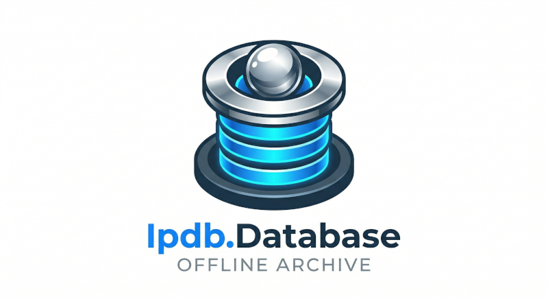

<p align="center">
	
</p>

# Ipdb.Database  [](https://github.com/xantari/Ipdb.Database/actions/workflows/build.yml) [](https://www.nuget.org/packages?q=Ipdb.Models)
Ipdb Database in .json format.

IPDB doesn't offer an open API so in order to allow for lookups / information querying in pinball 
related programs this was created to have more information then the current .csv files various programs have. 

Also there is no indication as to when those databases were last updated. This project aims to solve that and provide a more robust file format for interaction with IPDB data.

This approach lessens the load on IPDB servers versus doing on the fly parsing of IPDB data from the website in real-time.

Database set to refresh monthly automatically. 

# Latest Database

[IPDB Database (.json)](https://github.com/xantari/Ipdb.Database/raw/master/Database/ipdbdatabase.json)

# Loading the database (C#)

Grab the nuget package ([Ipdb.Models](https://www.nuget.org/packages/Ipdb.Models)).

```cs
var data = JsonConvert.DeserializeObject<IpdbDatabase>(File.ReadAllText(@"{pathToJson}\\ipdbdatabase.json"));
```